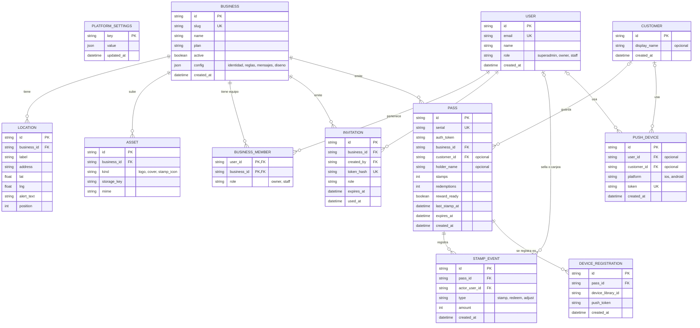
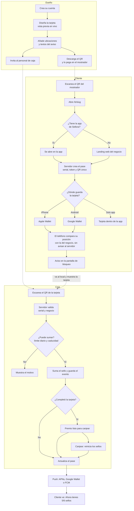
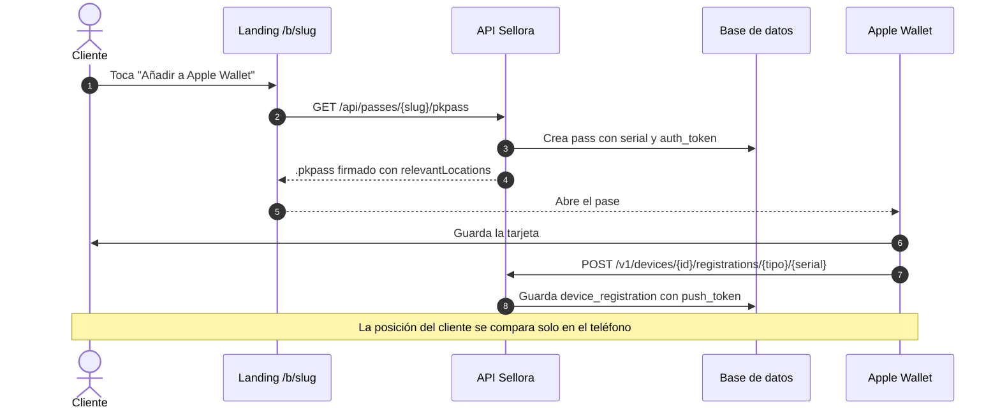
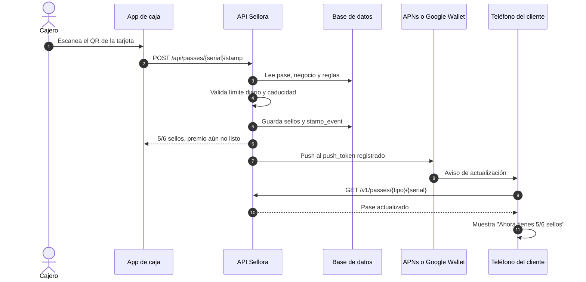

# Diagramas de Sellora

Se ven renderizados en GitHub, GitLab y en la mayoría de editores con soporte Mermaid.

## 1. Modelo de datos (ER)

Notas del modelo:

- **No se guarda la ubicación del cliente.** Ninguna tabla tiene campos de posición del cliente. `location` es la dirección del negocio.
- **Cliente anónimo.** `customer` solo existe si el cliente usa la app. Se crea al primer uso, sin correo ni teléfono. Quien usa solo el Wallet no tiene fila en `customer`.
- **Una tarjeta por cliente y negocio.** `pass` es única por (`business_id`, `customer_id`) cuando hay cliente.
- **Cuentas y sesiones** las gestiona Better Auth (`account`, `session`, `verification`). No se dibujan aquí.
- **`business.config`** guarda en JSON la identidad, las reglas, los mensajes y el diseño del pase. Se valida con zod en `packages/shared`.

## 2. Flujo del producto

## 3. Alta de la tarjeta y registro del dispositivo

## 4. Sumar un sello y actualizar el pase

